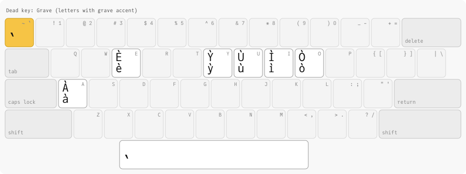
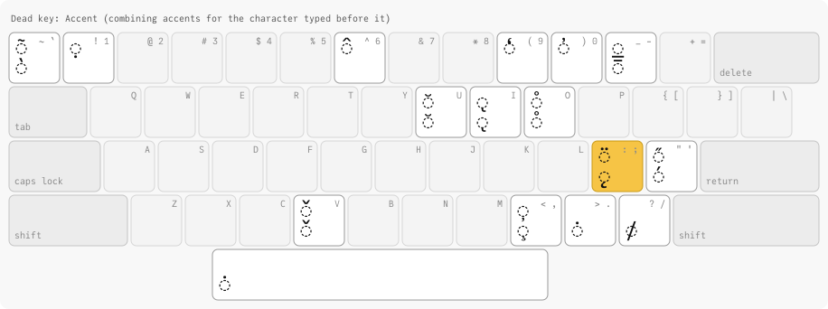
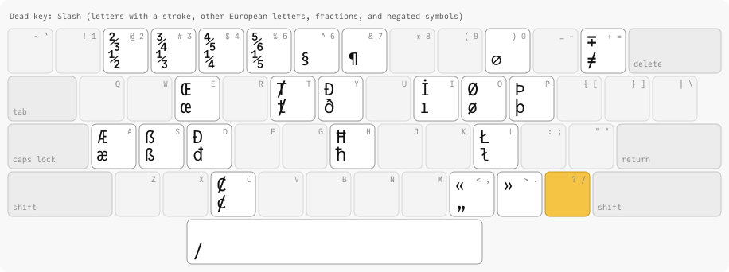
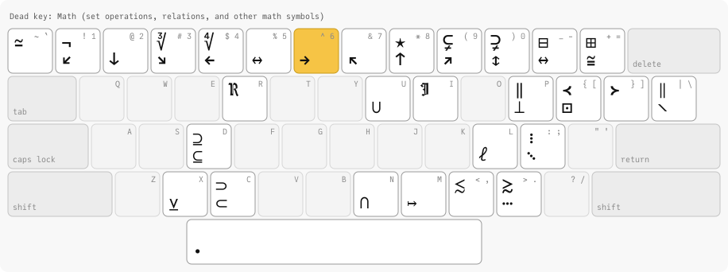
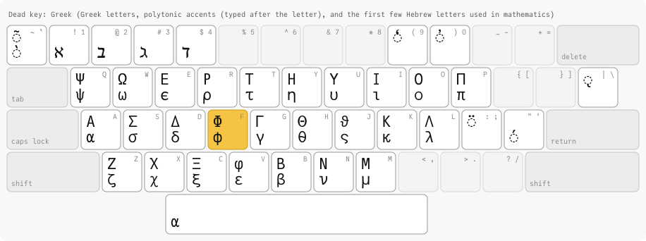
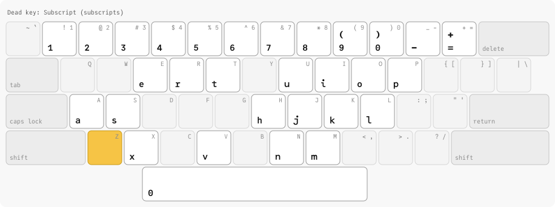
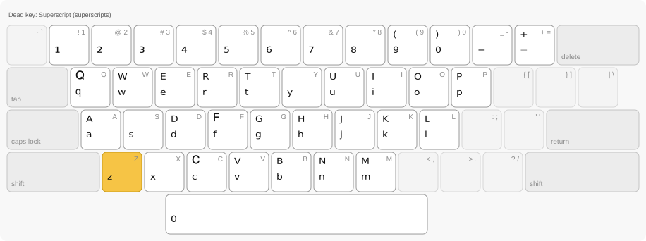
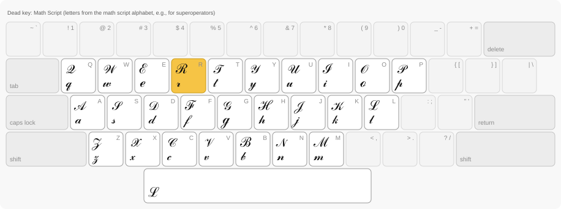
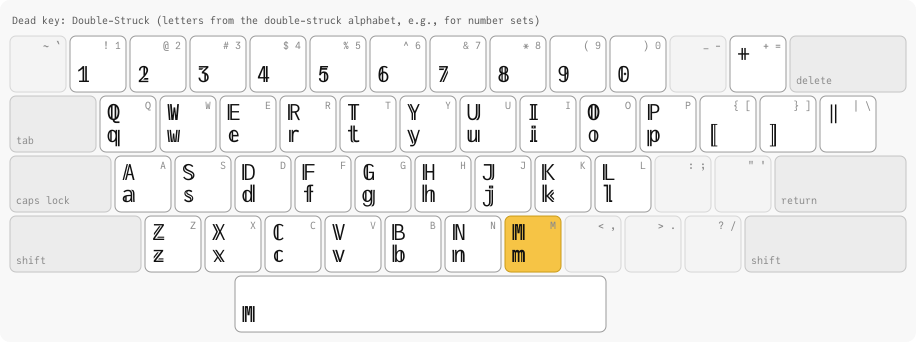
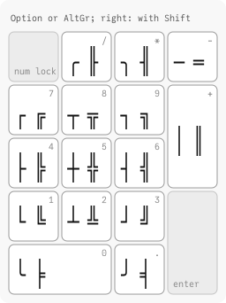

# U.S. Scientific

[](https://github.com/goerz/us-scientific-keyboard/actions/workflows/ci.yml)
[](https://github.com/goerz/us-scientific-keyboard/releases/latest)
[](LICENSE)

A keyboard layout for typing Unicode math and European accented characters directly, on a standard US keyboard, on macOS, Windows, and Linux.

<!-- BEGIN generated: count -->

It types **about 630 characters beyond ASCII**, 110 of them directly with Option or AltGr and the rest through dead keys. 23 are combining accents, which go on any letter (`ǖ`, `ṩ`, `x̲`), so you can also type the roughly 580 accented characters that Unicode has as single characters (330 Latin, 240 Greek, and a few symbols such as `≮`): **about 1,200 in all**.

<!-- END generated: count -->

Without modifiers, it is the standard US layout. The alternative layer (Option on macOS, AltGr, that is, the right Alt key, on Windows and Linux) adds:

* Umlauts and other common accented letters (ä, ö, ü, ß, ç, ñ)
* Frequently used math and physics symbols (∂, ∇, ∫, ∑, ∞, ≈, ≡, ≤, ⊗, ⟨, ⟩, ℏ, †, …)
* Combining accents that apply to the preceding character (v⃗, Ĥ, S̃, z̅)
* Box drawing on the number pad (┌ ┬ ┐ ─ │, ╔ ╦ ╗ ═ ║, …)
* Dead keys for Greek letters, subscripts, superscripts, acute and grave accents, combining accents for European languages and polytonic Greek (č, ā, å, ő, ą, ș, ἅ, ᾳ, ẋ, …), letters with a stroke and other European letters (ø, ł, đ, æ, œ, «, »), fractions (½, ⅓, ¾), negated relations (≠, ≢, ≰, ∄, ⇏), set notation and other math symbols (∪, ∩, ⊂, ⊆, ⟂, ‖, ℓ, ↦, ≲, ⨁), and the bold, script, and double-struck math alphabets

The idea is to type everyday "Unicode math" (in chat, email, or web forms) without round-tripping through an editor with [digraphs](https://vimdoc.sourceforge.net/htmldoc/digraph.html) or [julia-vim](https://github.com/JuliaEditorSupport/julia-vim). The selection of symbols skews toward quantum physics.

This is the successor of [USScientific.bundle](https://github.com/goerz/USScientific.bundle), the macOS-only "U.S. International - Scientific" layout made with Ukelele.

<!-- BEGIN generated: toc -->

* [Alternative layer](#alternative-layer)
* [Dead keys](#dead-keys): [Acute](#acute-dead-key), [Grave](#grave-dead-key), [Accent](#accent-dead-key), [Slash](#slash-dead-key), [Math](#math-dead-key), [Greek](#greek-dead-key), [Subscript](#subscript-dead-key), [Superscript](#superscript-dead-key), [Math Script](#math-script-dead-key), [Math Bold](#math-bold-dead-key), [Double-Struck](#double-struck-dead-key)
* [Number pad](#number-pad)
* [Installation](#installation): [macOS](#macos), [Windows (Keyman)](#windows-keyman), [Windows (native layout)](#windows-native-layout), [Linux](#linux), [Linux (Keyman)](#linux-keyman)
* [Changing the layout](#changing-the-layout)
* [Building](#building)
* [License](#license)

<!-- END generated: toc -->


The key notation below is the one used on macOS: `⌥` is Option (AltGr on Windows and Linux) and `⇧` is Shift.


## Alternative layer

<!-- BEGIN generated: alternative -->

#### Option or AltGr

| Keys | Character | Description |
|------|-----------|-------------|
| `` ⌥` `` | | dead key for letters with grave accent (see [Grave](#grave-dead-key)) |
| `⌥1` | `′` | prime |
| `⌥2` | `²` | square |
| `⌥3` | `³` | cube |
| `⌥4` | `∀` | for all |
| `⌥5` | `◌̅` | combining over-bar for the previous character, e.g., `z⌥5` gives `z̅` (complex conjugate) |
| `⌥6` | | dead key for set operations, relations, and other math symbols (see [Math](#math-dead-key)) |
| `⌥7` | `≡` | identical to |
| `⌥8` | `∞` | infinity |
| `⌥9` | `Å` | Ångström |
| `⌥0` | `°` | degree |
| `⌥-` | `–` | en-dash |
| `⌥=` | `≈` | almost equal |
| `⌥q` | `α` | Greek alpha |
| `⌥w` | `ω` | Greek omega (angular frequency) |
| `⌥e` | `∈` | element of (not to be confused with Greek `ϵ` or `ε`) |
| `⌥r` | `ρ` | Greek rho (density matrix) |
| `⌥t` | `↑` | up arrow |
| `⌥y` | `Ψ` | Greek capital Psi (state vector) |
| `⌥u` | `ü` | umlaut |
| `⌥i` | `𝕚` | double-struck i (imaginary unit) |
| `⌥o` | `ö` | umlaut |
| `⌥p` | `π` | Greek pi |
| `⌥[` | `⟨` | left angle bracket (bra, `⟨Ψ\|`) |
| `⌥]` | `⟩` | right angle bracket (ket, `\|Ψ⟩`) |
| `⌥\` | `≪` | much less than (not the guillemet `«`, which is `⌥/<`) |
| `⌥a` | `ä` | umlaut |
| `⌥s` | `ß` | German sharp s (not to be confused with Greek `β`) |
| `⌥d` | `∂` | partial derivative |
| `⌥f` | | dead key for Greek letters, polytonic accents (typed after the letter), and the first few Hebrew letters used in mathematics (see [Greek](#greek-dead-key)) |
| `⌥g` | `↓` | down arrow |
| `⌥h` | `ℏ` | reduced Planck constant |
| `⌥j` | `←` | left arrow |
| `⌥k` | `→` | right arrow |
| `⌥l` | `◌⃗` | combining over-arrow (vector) for the previous character, e.g., `v⌥l` gives `v⃗` |
| `⌥;` | | dead key for combining accents for the character typed before it (see [Accent](#accent-dead-key)) |
| `⌥'` | | dead key for letters with acute accent (see [Acute](#acute-dead-key)) |
| `⌥z` | | dead key for subscripts (see [Subscript](#subscript-dead-key)) |
| `⌥x` | `×` | multiplication sign, e.g., `3×10⁻³` |
| `⌥c` | `ç` | c with cedilla |
| `⌥v` | `∨` | logical or |
| `⌥b` | `β` | Greek beta |
| `⌥n` | `ñ` | n with tilde |
| `⌥m` | `µ` | micro sign, e.g., `µm` |
| `⌥,` | `∝` | proportional to |
| `⌥.` | `…` | ellipsis |
| `⌥/` | | dead key for letters with a stroke, other European letters, fractions, and negated symbols (see [Slash](#slash-dead-key)) |
| `⌥Space` |  | no-break space |

#### Shift with Option or AltGr

| Keys | Character | Description |
|------|-----------|-------------|
| `` ⌥⇧` `` | `◌̃` | combining over-tilde for the previous character, e.g., ``S⌥⇧` `` gives `S̃` (Fourier transform) |
| `⌥⇧1` | `¡` | inverted exclamation mark |
| `⌥⇧2` | `√` | square root |
| `⌥⇧3` | `∫` | integral |
| `⌥⇧4` | `€` | euro |
| `⌥⇧5` | `÷` | division sign (integer division in Julia) |
| `⌥⇧6` | `◌̂` | combining hat for the previous character, e.g., `H⌥⇧6` gives `Ĥ` (operator) |
| `⌥⇧7` | `∼` | tilde operator (of the order of, scales as; not the ASCII `~`) |
| `⌥⇧8` | `⋅` | dot operator (inner product) |
| `⌥⇧9` | `‘` | left single quotation mark |
| `⌥⇧0` | `’` | right single quotation mark |
| `⌥⇧-` | `—` | em-dash |
| `⌥⇧=` | `±` | plus-minus |
| `⌥⇧q` | `⊕` | circled plus (direct sum, XOR, `\oplus`; the n-ary `⨁` is `⌥6⌥⇧q`) |
| `⌥⇧w` | `∘` | ring operator (function composition in Julia) |
| `⌥⇧e` | `∉` | not an element of |
| `⌥⇧r` | | dead key for letters from the math script alphabet, e.g., for superoperators (see [Math Script](#math-script-dead-key)) |
| `⌥⇧t` | `†` | dagger (Hermitian conjugate) |
| `⌥⇧y` | `Φ` | Greek capital Phi |
| `⌥⇧u` | `Ü` | umlaut |
| `⌥⇧i` | `𝟙` | double-struck 1 (identity operator) |
| `⌥⇧o` | `Ö` | umlaut |
| `⌥⇧p` | `∏` | product (not to be confused with Greek `Π`) |
| `⌥⇧[` | `“` | left double quotation mark |
| `⌥⇧]` | `”` | right double quotation mark |
| `⌥⇧\` | `≫` | much greater than (not the guillemet `»`, which is `⌥/>`) |
| `⌥⇧a` | `Ä` | umlaut |
| `⌥⇧s` | `∑` | sum (not to be confused with Greek `Σ`) |
| `⌥⇧d` | `Δ` | Greek capital Delta |
| `⌥⇧f` | | dead key for letters from the math bold alphabet, e.g., for vectors (see [Math Bold](#math-bold-dead-key)) |
| `⌥⇧g` | `Γ` | Greek capital Gamma |
| `⌥⇧h` | `ℋ` | script H (Hilbert space) |
| `⌥⇧j` | `⇐` | double left arrow |
| `⌥⇧k` | `⇒` | double right arrow (implies) |
| `⌥⇧l` | `⇔` | double left-right arrow (logically equivalent) |
| `⌥⇧;` | `∃` | there exists |
| `⌥⇧'` | `″` | double prime |
| `⌥⇧z` | | dead key for superscripts (see [Superscript](#superscript-dead-key)) |
| `⌥⇧x` | `⊗` | circled times (tensor or Kronecker product, `\otimes`; the n-ary `⨂` is `⌥6⌥⇧x`) |
| `⌥⇧c` | `Ç` | capital C with cedilla |
| `⌥⇧v` | `∧` | logical and |
| `⌥⇧b` | `∇` | nabla (gradient) |
| `⌥⇧n` | `Ñ` | capital N with tilde |
| `⌥⇧m` | | dead key for letters from the double-struck alphabet, e.g., for number sets (see [Double-Struck](#double-struck-dead-key)) |
| `⌥⇧,` | `≤` | less than or equal |
| `⌥⇧.` | `≥` | greater than or equal |
| `⌥⇧/` | `¿` | inverted question mark |

<!-- END generated: alternative -->

With Caps Lock on, letters are typed in uppercase, including after a dead key; the umlauts, `ç`, and `ñ` on the alternative layer are uppercased as well. Caps Lock doesn't affect any other key.


## Dead keys

A dead key types nothing by itself but changes what the next key types. Press the dead key, release it, and then press the next key. For example, `⌥f` followed by `a` gives `α`, and `⌥z` followed by `2` gives `₂`. Space after a dead key types its symbol. If the next key has no special meaning for the dead key, you get the dead key's symbol followed by the key's normal character.

In the diagrams, dead keys show their symbol on a dark badge. In each dead key's diagram, the key that triggers it is highlighted.

<!-- BEGIN generated: dead-key-table -->

| Keys | Symbol | Dead key for |
|------|--------|--------------|
| `⌥'` | `'` | [letters with acute accent](#acute-dead-key) |
| `` ⌥` `` | `` ` `` | [letters with grave accent](#grave-dead-key) |
| `⌥;` | `◌̇` | [combining accents for the character typed before it](#accent-dead-key) |
| `⌥/` | `/` | [letters with a stroke, other European letters, fractions, and negated symbols](#slash-dead-key) |
| `⌥6` | `⋅` | [set operations, relations, and other math symbols](#math-dead-key) |
| `⌥f` | `α` | [Greek letters, polytonic accents (typed after the letter), and the first few Hebrew letters used in mathematics](#greek-dead-key) |
| `⌥z` | `₀` | [subscripts](#subscript-dead-key) |
| `⌥⇧z` | `⁰` | [superscripts](#superscript-dead-key) |
| `⌥⇧r` | `ℒ` | [letters from the math script alphabet, e.g., for superoperators](#math-script-dead-key) |
| `⌥⇧f` | `𝐅` | [letters from the math bold alphabet, e.g., for vectors](#math-bold-dead-key) |
| `⌥⇧m` | `𝕄` | [letters from the double-struck alphabet, e.g., for number sets](#double-struck-dead-key) |

<!-- END generated: dead-key-table -->

<!-- BEGIN generated: dead-keys -->

### Acute dead key

`⌥'`, then a key: letters with acute accent. Space types `'`.


### Grave dead key

`` ⌥` ``, then a key: letters with grave accent. Space types `` ` ``.



### Accent dead key

`⌥;`, then a key: combining accents for the character typed before it. Space types `◌̇`.



The Accent dead key goes *after* the letter, because it types a combining mark, which attaches to the character before it: `c⌥;v` gives `č`, `x⌥;` followed by Space gives `ẋ`, and `x⌥;:` gives `ẍ`. Marks stack, so `α⌥;(⌥;'` gives `ἅ` (rough breathing, then acute). The result is the letter followed by the mark (`c` + U+030C), which is canonically equivalent to the precomposed `č`: it looks the same, but software that doesn't normalize Unicode, such as `grep`, treats the two as different.

| Key | Symbol | Description |
|-----|--------|-------------|
| `.` | `◌̇` | dot above, e.g., `x⌥;.` gives `ẋ` (time derivative), `z⌥;.` gives `ż` |
| `:` | `◌̈` | diaeresis (umlaut), e.g., `x⌥;:` gives `ẍ`, `e⌥;:` gives `ë` |
| `'` | `◌́` | acute, e.g., `s⌥;'` gives `ś`, `α⌥;'` gives `ά` (Greek tonos or oxia) |
| `` ` `` | `◌̀` | grave, e.g., ``α⌥;` `` gives `ὰ` (Greek varia) |
| `^` | `◌̂` | circumflex, e.g., `w⌥;^` gives `ŵ`; also on `⌥⇧6` |
| `v`, `V` | `◌̌` | caron (háček), e.g., `c⌥;v` gives `č` |
| `-` | `◌̄` | macron (not the overline on `⌥5`), e.g., `a⌥;-` gives `ā` |
| `o`, `O` | `◌̊` | ring above, e.g., `a⌥;o` gives `å`, `u⌥;o` gives `ů` |
| `u`, `U` | `◌̆` | breve, e.g., `g⌥;u` gives `ğ`, `a⌥;u` gives `ă` |
| `,` | `◌̧` | cedilla, e.g., `s⌥;,` gives `ş` (Turkish) |
| `<` | `◌̦` | comma below, e.g., `s⌥;<` gives `ș` (Romanian; not the cedilla) |
| `;` | `◌̨` | ogonek, e.g., `a⌥;;` gives `ą` |
| `"` | `◌̋` | double acute, e.g., `o⌥;"` gives `ő` (Hungarian) |
| `(` | `◌̔` | rough breathing (dasia), e.g., `α⌥;(` gives `ἁ` |
| `)` | `◌̓` | smooth breathing (psili), e.g., `α⌥;)` gives `ἀ` |
| `~` | `◌̃` | tilde, e.g., `a⌥;~` gives `ã`; the Greek circumflex (perispomeni) is on `⌥f~`; also on `` ⌥⇧` `` |
| `i`, `I` | `◌ͅ` | iota subscript (ypogegrammeni), e.g., `α⌥;i` gives `ᾳ` |
| `/` | `◌̸` | long solidus overlay (negation), e.g., `⊂⌥;/` gives `⊄` |
| `_` | `◌̲` | low line (underline), e.g., `v⌥;_` gives `v̲` |
| `!` | `◌̣` | dot below, e.g., `h⌥;!` gives `ḥ` |

### Slash dead key

`⌥/`, then a key: letters with a stroke, other European letters, fractions, and negated symbols. Space types `/`.



The digits `2` to `5` give the fractions 1/n (`½ ⅓ ¼ ⅕`), and with Shift, n/(n+1) (`⅔ ¾ ⅘ ⅚`).

| Key | Symbol | Description |
|-----|--------|-------------|
| `a` / `A` | `æ` `Æ` | ae ligature (Danish, Norwegian, Icelandic) |
| `c` / `C` | `ȼ` `Ȼ` | c with stroke |
| `d` / `D` | `đ` `Đ` | d with stroke (Croatian, Serbian, Vietnamese) |
| `e` / `E` | `œ` `Œ` | oe ligature (French) |
| `g` | `©` | copyright sign (on `⌥g` in Apple's US layout) |
| `G` | `™` | trade mark sign (on `⌥2` in Apple's US layout) |
| `h` / `H` | `ħ` `Ħ` | h with stroke (Maltese; not `ℏ`) |
| `i` | `ı` | dotless i (Turkish) |
| `I` | `İ` | capital I with dot above (Turkish) |
| `l` / `L` | `ł` `Ł` | l with stroke |
| `o` / `O` | `ø` `Ø` | o with stroke |
| `p` / `P` | `þ` `Þ` | thorn (Icelandic) |
| `r` | `®` | registered sign (on `⌥r` in Apple's US layout) |
| `s` | `ß` | German sharp s (not to be confused with Greek `β`); also on `⌥s` |
| `S` | `ẞ` | capital sharp s |
| `t` / `T` | `ⱦ` `Ⱦ` | t with diagonal stroke |
| `y` / `Y` | `ð` `Ð` | eth (Icelandic) |
| `,` | `„` | low double quotation mark, the German opening quote (the closing quote is `“` on `⌥⇧[`) |
| `<` | `«` | left guillemet (not `≪`, much less than, on `⌥\`) |
| `>` | `»` | right guillemet (not `≫`, much greater than, on `⌥⇧\`) |
| `0` | `∅` | empty set |
| `2` | `½` | vulgar fraction one half |
| `@` | `⅔` | vulgar fraction two thirds |
| `3` | `⅓` | vulgar fraction one third |
| `#` | `¾` | vulgar fraction three quarters |
| `4` | `¼` | vulgar fraction one quarter |
| `$` | `⅘` | vulgar fraction four fifths |
| `5` | `⅕` | vulgar fraction one fifth |
| `%` | `⅚` | vulgar fraction five sixths |
| `6` | `§` | section sign (on `⌥6` in Apple's US layout) |
| `7` | `¶` | pilcrow, paragraph sign (on `⌥7` in Apple's US layout) |
| `=` | `≠` | not equal to |
| `⌥7` (`≡`) | `≢` | not identical to |
| `+`, `⌥⇧=` (`±`) | `∓` | minus-plus |
| `⌥⇧;` (`∃`) | `∄` | there does not exist |
| `⌥=` (`≈`) | `≉` | not almost equal to |
| `⌥⇧7` (`∼`) | `≁` | not tilde |
| `⌥⇧,` (`≤`) | `≰` | neither less-than nor equal to |
| `⌥⇧.` (`≥`) | `≱` | neither greater-than nor equal to |
| `⌥k` (`→`) | `↛` | rightwards arrow with stroke |
| `⌥⇧k` (`⇒`) | `⇏` | rightwards double arrow with stroke |
| `⌥⇧l` (`⇔`) | `⇎` | left right double arrow with stroke |

### Math dead key

`⌥6`, then a key: set operations, relations, and other math symbols. Space types `⋅`.



The digits give arrows in the directions they have on the number pad (`8` up, `3` down and right, `5` and `0` left-right and up-down), so the arrows also work with the number pad after `⌥6`.

After `⌥6`, a key that types a symbol with Option gives a related symbol. For example, `⌥6⌥⇧,` gives `⪯`, the curly version of `≤`, which is on `⌥⇧,`.

- `⌥j` (`←`), `⌥k` (`→`), `⌥⇧j` (`⇐`), `⌥⇧k` (`⇒`), and `⌥⇧l` (`⇔`) give the long arrows `⟵ ⟶ ⟸ ⟹ ⟺`; for example, `⌥6⌥⇧k` gives `⟹` (`\implies`), the long version of the `⇒` on `⌥⇧k`
- `⌥⇧q` (`⊕`) and `⌥⇧x` (`⊗`) give the n-ary `⨁ ⨂`
- `⌥=` (`≈`) gives `≊`
- `⌥⇧,` (`≤`) and `⌥⇧.` (`≥`) give the curly `⪯ ⪰`
- `⌥e` (`∈`) and `⌥⇧e` (`∉`) give the reversed `∋ ∌`
- `⌥⇧v` (`∧`) and `⌥v` (`∨`) give the barred `⊼ ⊽` (`nand`, `nor`)
- `⌥⇧8` (`⋅`) and `⌥-` (`–`) give the circled `⊙ ⊖`
- `⌥x` (`×`) gives the squared `⊠` (the circled `⊗` is on `⌥⇧x`)
- `⌥⇧w` (`∘`) gives `⨟`, composition in the other order
- `⌥[` (`⟨`) and `⌥]` (`⟩`) give the triangles `◁ ▷` (series product in SLH)

After `⌥6`, other keys go by their shape or name:

- the brackets `(`, `)` give `⊊ ⊋`, the curly `{`, `}` give `≺ ≻`, and the square `[` gives the squared `⊡`
- `+` and `_` give the squared `⊞ ⊟`
- `d` and `D` give `⊆ ⊇`, on the key above `c` and `C` (`⊂ ⊃`), and `⊇` looks like a D
- with Option, the keys of the set symbols give their square versions: `⌥c`, `⌥d`, `⌥⇧c`, `⌥⇧d` (the keys of `⊂ ⊆ ⊃ ⊇`) give `⊏ ⊑ ⊐ ⊒`, and `⌥n`, `⌥u` (the keys of `∩ ∪`) give `⊓ ⊔`
- Shift+3 and Shift+4 (`#`, `$`) give the roots `∛` and `∜`
- `x` gives `⊻` (`xor`)
- `!` gives `¬` (not)
- `=` gives `≅`

With these, every Unicode operator of Julia's Base can be typed. The negated `⊈` and `⊉` are `⊆` and `⊇` (`⌥6d`, `⌥6D`) followed by the combining long solidus (`⌥;/`), which Julia reads as the same operator.

| Key | Symbol | Description |
|-----|--------|-------------|
| `c` | `⊂` | subset of |
| `C` | `⊃` | superset of |
| `d` | `⊆` | subset of or equal to |
| `D` | `⊇` | superset of or equal to |
| `(` | `⊊` | proper subset (`\subsetneq`) |
| `)` | `⊋` | proper superset (`\supsetneq`) |
| `n` | `∩` | intersection |
| `u` | `∪` | union |
| `\` | `∖` | set minus |
| `⌥e` (`∈`) | `∋` | contains as member (`in` with the arguments swapped in Julia, `\ni`) |
| `⌥⇧e` (`∉`) | `∌` | does not contain as member (`\nni`) |
| `⌥c` (`ç`) | `⊏` | square image of (`\sqsubset`) |
| `⌥⇧c` (`Ç`) | `⊐` | square original of (`\sqsupset`) |
| `⌥d` (`∂`) | `⊑` | square image of or equal (partial order, `\sqsubseteq`) |
| `⌥⇧d` (`Δ`) | `⊒` | square original of or equal (`\sqsupseteq`) |
| `⌥n` (`ñ`) | `⊓` | square cap (meet, `\sqcap`) |
| `⌥u` (`ü`) | `⊔` | square cup (join, `\sqcup`) |
| `x` | `⊻` | exclusive or (`xor` in Julia, `\xor`) |
| `⌥⇧v` (`∧`) | `⊼` | nand (`nand` in Julia, `\nand`) |
| `⌥v` (`∨`) | `⊽` | nor (`nor` in Julia, `\nor`) |
| `!` | `¬` | logical not (`\neg`) |
| `=` | `≅` | approximately equal to, congruent (`\cong`) |
| `~` | `≃` | asymptotically equal to |
| `⌥=` (`≈`) | `≊` | almost equal or equal to (`\approxeq`) |
| `<` | `≲` | less than or of the order of |
| `>` | `≳` | greater than or of the order of |
| `{` | `≺` | precedes (`\prec`) |
| `}` | `≻` | succeeds (`\succ`) |
| `⌥⇧,` (`≤`) | `⪯` | precedes or equal (`\preceq`) |
| `⌥⇧.` (`≥`) | `⪰` | succeeds or equal (`\succeq`) |
| `p` | `⟂` | perpendicular, `\perp` in Julia (not the up tack `⊥`, `\bot`) |
| `P` | `∥` | parallel (`\parallel`) |
| `\|` | `‖` | double vertical line (norm, `\Vert` in Julia and LaTeX) |
| `⌥⇧8` (`⋅`) | `⊙` | circled dot (Hadamard product, `\odot`) |
| `⌥-` (`–`) | `⊖` | circled minus (`\ominus`) |
| `⌥x` (`×`) | `⊠` | squared times (`\boxtimes`) |
| `[` | `⊡` | squared dot (double contraction, `\boxdot`) |
| `+` | `⊞` | squared plus (`\boxplus`; concatenation in SLH) |
| `_` | `⊟` | squared minus (`\boxminus`) |
| `⌥[` (`⟨`) | `◁` | white left-pointing triangle (series product in SLH, `\triangleleft`; not an operator in Julia) |
| `⌥]` (`⟩`) | `▷` | white right-pointing triangle (`\triangleright`; an operator in Julia, with the precedence of `*`) |
| `*` | `⋆` | star operator (`\star`) |
| `⌥⇧w` (`∘`) | `⨟` | forward composition, `f ⨟ g` is `g ∘ f` (`\bbsemi`) |
| `⌥⇧q` (`⊕`) | `⨁` | n-ary circled plus (direct sum of many, `\bigoplus`) |
| `⌥⇧x` (`⊗`) | `⨂` | n-ary circled times (tensor product of many, `\bigotimes`) |
| `#` | `∛` | cube root (`cbrt` in Julia, `\cbrt`) |
| `$` | `∜` | fourth root (`fourthroot` in Julia, `\fourthroot`) |
| `l` | `ℓ` | script l (angular momentum) |
| `m` | `↦` | maps to |
| `.` | `⋯` | midline ellipsis (`\cdots`) |
| `:` | `⋮` | vertical ellipsis (`\vdots`) |
| `;` | `⋱` | down right diagonal ellipsis (`\ddots`) |
| `-`, `5` | `↔` | left-right arrow |
| `7` | `↖` | north west arrow |
| `8` | `↑` | up arrow; also on `⌥t` |
| `9` | `↗` | north east arrow |
| `4` | `←` | left arrow; also on `⌥j` |
| `6` | `→` | right arrow; also on `⌥k` |
| `1` | `↙` | south west arrow |
| `2` | `↓` | down arrow; also on `⌥g` |
| `3` | `↘` | south east arrow |
| `0` | `↕` | up down arrow |
| `⌥j` (`←`) | `⟵` | long leftwards arrow (`\longleftarrow`) |
| `⌥k` (`→`) | `⟶` | long rightwards arrow (`\longrightarrow`) |
| `⌥⇧j` (`⇐`) | `⟸` | long leftwards double arrow (`\impliedby`, `\Longleftarrow`) |
| `⌥⇧k` (`⇒`) | `⟹` | long rightwards double arrow (`\implies`, `\Longrightarrow`) |
| `⌥⇧l` (`⇔`) | `⟺` | long left right double arrow (`\iff`, `\Longleftrightarrow`) |

### Greek dead key

`⌥f`, then a key: Greek letters, polytonic accents (typed after the letter), and the first few Hebrew letters used in mathematics. Space types `α`.



The Greek dead key follows LaTeX and Julia: `⌥fe` gives `ϵ` (`\epsilon`) and `⌥ff` gives `ϕ` (`\phi`). These are the math symbols, not the letters of Greek text, which are `ε` (`\varepsilon`, on `v`) and `φ` (`\varphi`, on `V`). For Greek text, use `v` and `V`: an accent on `ϵ` doesn't normalize to a precomposed letter, while `ε⌥f'` becomes `έ`.

| Key | Symbol | Description |
|-----|--------|-------------|
| `a` / `A` | `α` `Α` | Greek alpha; `α` also on `⌥q` |
| `b` / `B` | `β` `Β` | Greek beta; `β` also on `⌥b` |
| `c` / `C` | `ξ` `Ξ` | Greek xi |
| `d` / `D` | `δ` `Δ` | Greek delta; `Δ` also on `⌥⇧d` |
| `e` / `E` | `ϵ` `Ε` | Greek lunate epsilon, `\epsilon` in LaTeX and Julia: the math symbol, not the letter `ε` of Greek text (on `v`), and not `∈` |
| `f` / `F` | `ϕ` `Φ` | Greek phi, `\phi` in LaTeX and Julia: the math symbol, not the letter `φ` of Greek text (on `V`); `Φ` also on `⌥⇧y` |
| `g` / `G` | `γ` `Γ` | Greek gamma; `Γ` also on `⌥⇧g` |
| `h` / `H` | `θ` `Θ` | Greek theta |
| `i` / `I` | `ι` `Ι` | Greek iota |
| `j` | `ς` | Greek final sigma, `\varsigma` in LaTeX |
| `J` | `ϑ` | Greek theta, `\vartheta` in LaTeX |
| `k` / `K` | `κ` `Κ` | Greek kappa |
| `l` / `L` | `λ` `Λ` | Greek lamda |
| `m` / `M` | `μ` `Μ` | Greek mu |
| `n` / `N` | `ν` `Ν` | Greek nu |
| `o` / `O` | `ο` `Ο` | Greek omicron |
| `p` / `P` | `π` `Π` | Greek pi; `π` also on `⌥p` |
| `q` / `Q` | `ψ` `Ψ` | Greek psi; `Ψ` also on `⌥y` |
| `r` / `R` | `ρ` `Ρ` | Greek rho (density matrix); `ρ` also on `⌥r` |
| `s` / `S` | `σ` `Σ` | Greek sigma |
| `t` / `T` | `τ` `Τ` | Greek tau |
| `u` / `U` | `υ` `Υ` | Greek upsilon |
| `v` | `ε` | Greek epsilon, `\varepsilon` in LaTeX and Julia: the letter of Greek text |
| `V` | `φ` | Greek phi, `\varphi` in LaTeX and Julia: the letter of Greek text |
| `w` / `W` | `ω` `Ω` | Greek omega (angular frequency); `ω` also on `⌥w` |
| `x` / `X` | `χ` `Χ` | Greek chi |
| `y` / `Y` | `η` `Η` | Greek eta |
| `z` / `Z` | `ζ` `Ζ` | Greek zeta |
| `1` | `ℵ` | alef symbol |
| `2` | `ℶ` | bet symbol |
| `3` | `ℷ` | gimel symbol |
| `4` | `ℸ` | dalet symbol |
| `⌥b` (`β`) | `ϐ` | Greek curled beta |
| `⌥p` (`π`) | `ϖ` | Greek pi, `\varpi` in LaTeX |
| `⌥r` (`ρ`) | `ϱ` | Greek rho, `\varrho` in LaTeX |
| `'` | `◌́` | acute (oxia, tonos), after the letter, e.g., `α⌥f'` gives `ά` |
| `` ` `` | `◌̀` | grave (varia), after the letter, e.g., ``α⌥f` `` gives `ὰ` |
| `~` | `◌͂` | circumflex (perispomeni), after the letter, e.g., `α⌥f~` gives `ᾶ` |
| `(` | `◌̔` | rough breathing (dasia), after the letter, e.g., `α⌥f(` gives `ἁ`, `α⌥f(⌥f'` gives `ἅ` |
| `)` | `◌̓` | smooth breathing (psili), after the letter, e.g., `α⌥f)` gives `ἀ` |
| `:` | `◌̈` | diaeresis (dialytika), after the letter, e.g., `ι⌥f:` gives `ϊ` |
| `\|` | `◌ͅ` | iota subscript (ypogegrammeni), after the letter, e.g., `α⌥f\|` gives `ᾳ` |

### Subscript dead key

`⌥z`, then a key: subscripts. Space types `₀`.



Unicode doesn't have a complete alphabet of subscripts, so some letters are missing. Of the Greek subscripts, `ᵦ` and `ᵨ` follow `⌥b` (`β`) and `⌥r` (`ρ`); `ᵧ`, `ᵩ`, and `ᵪ` are on `G`, `F`, and `X`, the keys of `γ`, `ϕ`, and `χ` in the Greek dead key (uppercase, so the lowercase keys stay free for Latin subscripts Unicode might add).

With an alternative character after the dead key: `⌥b` (`β`) gives `ᵦ`, `⌥r` (`ρ`) gives `ᵨ`.

### Superscript dead key

`⌥⇧z`, then a key: superscripts. Space types `⁰`.



Unicode doesn't have a complete alphabet of superscripts, so some letters are missing. A few of them, the superscript capital C, F, and Q and small q (on `C`, `F`, `Q`, and `q`), were only added in Unicode 14 and are missing from many fonts.

With an alternative character after the dead key: `⌥q` (`α`) gives `ᵅ`, `⌥b` (`β`) gives `ᵝ`.

### Math Script dead key

`⌥⇧r`, then a key: letters from the math script alphabet, e.g., for superoperators. Space types `ℒ`.



### Math Bold dead key

`⌥⇧f`, then a key: letters from the math bold alphabet, e.g., for vectors. Space types `𝐅`.


With an alternative character after the dead key: `⌥q` (`α`) gives `𝛂`, `⌥b` (`β`) gives `𝛃`, `⌥p` (`π`) gives `𝛑`, `⌥r` (`ρ`) gives `𝛒`, `⌥w` (`ω`) gives `𝛚`, `⌥⇧g` (`Γ`) gives `𝚪`, `⌥⇧d` (`Δ`) gives `𝚫`, `⌥⇧y` (`Φ`) gives `𝚽`, `⌥y` (`Ψ`) gives `𝚿`, `⌥⇧b` (`∇`) gives `𝛁`.

### Double-Struck dead key

`⌥⇧m`, then a key: letters from the double-struck alphabet, e.g., for number sets. Space types `𝕄`.



Some symbol keys give their doubled versions: `[` and `]` the double square brackets `⟦ ⟧`, `|` the double vertical line `‖` (norm; also on `⌥6|`), and `+` the double plus `⧺` (an operator in Julia, with the precedence of `+`). The double angle brackets `⟪ ⟫` are for vectors in Liouville space: `⌥⇧m⌥]` gives `⟫`, as in `|ρ⟫`.

With an alternative character after the dead key: `⌥[` (`⟨`) gives `⟪`, `⌥]` (`⟩`) gives `⟫`.

<!-- END generated: dead-keys -->

## Number pad

On a keyboard with a number pad, Option (AltGr on Windows and Linux) turns it into a pad for box drawing, in the shape of the keys: the digits give the corners, the tees, and the cross, `-` and `+` the horizontal and vertical lines, and `/ * 0 .` the rounded corners. With Shift, the same keys give double lines, and `/ * 0 .` the tees that join a single and a double line (`╟ ╢ ╞ ╡`, as in the cell markers of [Pluto](https://plutojl.org) notebooks).

Num Lock doesn't matter with Option or AltGr, and without them the number pad works as usual. After a dead key, a number pad key works like the key of the main keyboard that types the same character: `⌥z` followed by `2` on the number pad gives `₂`.

The native Windows layout doesn't have the box drawing (Windows uses Alt with the number pad to type characters by their code); the Keyman package does. Shift with AltGr on the number pad hasn't been tried in Keyman for Windows, where Shift with the number pad can switch Num Lock off instead.

<!-- BEGIN generated: numpad -->



| Key | Option or AltGr | Shift with Option or AltGr |
|-----|-----------------|----------------------------|
| `/` | `╭` | `╟` |
| `*` | `╮` | `╢` |
| `-` | `─` | `═` |
| `7` | `┌` | `╔` |
| `8` | `┬` | `╦` |
| `9` | `┐` | `╗` |
| `+` | `│` | `║` |
| `4` | `├` | `╠` |
| `5` | `┼` | `╬` |
| `6` | `┤` | `╣` |
| `1` | `└` | `╚` |
| `2` | `┴` | `╩` |
| `3` | `┘` | `╝` |
| `0` | `╰` | `╞` |
| `.` | `╯` | `╡` |

<!-- END generated: numpad -->


## Installation

Download the files from the [releases page](https://github.com/goerz/us-scientific-keyboard/releases).

From a clone of this repository, `make install` builds and installs the layout for the current user. On macOS, it installs the bundle and enables the layout right away, without logging out; select it in the input menu. When it replaces an earlier version, log out and back in, since macOS keeps using the version it has already loaded. `make install SYSTEM=1` installs it for all users instead (in `/Library/Keyboard Layouts`, asking for your password). On Linux, it installs the [native layout](#linux), and `make install-keyman` installs the Keyman package instead. `make uninstall` (or `make uninstall-keyman`) removes it.

### macOS

Unzip `us_scientific.bundle.zip` and copy `us_scientific.bundle` to `~/Library/Keyboard Layouts/` (for the current user) or `/Library/Keyboard Layouts/` (for all users). Log out and back in. Then add the layout in System Settings, under Keyboard, Text Input, Input Sources, as "U.S. Scientific" (in the English group).

If you used the predecessor, "U.S. International - Scientific", remove its `USScientific.bundle` from the same folder.

### Windows (Keyman)

[Keyman](https://keyman.com) supports the complete layout.

1. Install [Keyman for Windows](https://keyman.com/windows/) (free). On Windows on ARM, Keyman 19.0.182 or later is required.
2. Double-click `us_scientific.kmp` and click Install. The keyboard is added under English.
3. Switch to the layout with Win+Space.

Use the **right** Alt key (AltGr) wherever this README shows `⌥`. The left Alt key keeps its usual Windows behavior.

### Windows (native layout)

There is also a native Windows keyboard layout that doesn't need Keyman. It can't do everything:

* Native Windows dead keys can only produce characters from the Unicode Basic Multilingual Plane. The math bold dead key is therefore missing, and the script and double-struck dead keys only have the letters from the "Letterlike Symbols" block (`ℂ ℕ ℍ ℙ ℚ ℝ ℤ`, `ℬ ℰ ℱ ℋ ℐ ℒ ℳ ℛ ℯ ℊ ℴ`). The double-struck dead key's symbol is `ℍ`.
* `𝕚` and `𝟙` on AltGr+I and Shift+AltGr+I may not work in all programs.
* The [number pad](#number-pad) has no box drawing.
* Shift with Caps Lock on gives lowercase letters, as usual on Windows.

1. Unzip `us_scientific-windows.zip`.
2. In an Administrator PowerShell, change to the unzipped folder and run `powershell -ExecutionPolicy Bypass -File install.ps1`.
3. Sign out and back in. Switch to the layout with Win+Space.

To remove it, run `install.ps1 -Uninstall` the same way. The zip has the layout compiled for x64, x86, and ARM64 Windows, and its source; its `README.txt` explains how to compile it yourself with the free Visual Studio build tools.

The layout is installed, loaded, and checked key by key on Windows for every change to this repository, but it hasn't been tried in daily use yet.

### Linux

The native Linux layout needs no extra software: an XKB layout defines the keys, and a Compose file defines what the dead keys do.

1. Unzip `us_scientific-linux.zip`, and in the unzipped folder, run `python3 install.py` (from a clone of this repository: `make install`).
2. Log out and back in.
3. On GNOME, the script has added "English (U.S. Scientific)" to the input sources; switch to it with Super+Space. On KDE Plasma, add it in System Settings under Keyboard, Layouts. In Sway, use `input * xkb_layout us_scientific`.

Use the **right** Alt key (AltGr) wherever this README shows `⌥`.

The script installs the layout for the current user, as `~/.config/xkb/symbols/us_scientific` with an entry in `~/.config/xkb/rules/evdev.xml` for the keyboard settings, and the Compose file as `~/.config/us_scientific/Compose`. It includes the Compose file from `~/.XCompose` (which it creates if you have none) and from any other user Compose file of IBus or GTK. `python3 install.py --uninstall` (or `make uninstall`) removes all of it.

The limits:

* XKB layouts in `~/.config/xkb` work in Wayland sessions (GNOME, KDE Plasma, Sway, and others), which use libxkbcommon. The X server of an X11 session only reads its system folder; there, `install.py` prints a command that loads the layout until you log out.
* The dead keys need a program that reads `~/.XCompose`: GTK, IBus (which GNOME uses), Qt and KDE, fcitx5, and most terminals do. In one that doesn't (some Snap packages, for example), a dead key types nothing.
* After a dead key, `⌥i` (`𝕚`) and `⌥⇧i` (`𝟙`) cancel the dead key, because GTK and IBus can't use keys outside the Basic Multilingual Plane in Compose sequences.
* Shift with Caps Lock on gives lowercase letters on most letter keys, as usual on Linux, but uppercase letters on keys whose alternative characters aren't a lowercase-uppercase pair, such as `q` (`α` and `⊕`).

The layout has been checked with libxkbcommon 1.6 and 1.13 and IBus 1.5.34, but not yet on a Linux desktop.

### Linux (Keyman)

[Keyman for Linux](https://keyman.com/linux/) installs the same `us_scientific.kmp` package as Keyman for Windows (from a clone: `make install-keyman`). This hasn't been tested.


## Changing the layout

The whole layout is defined in [`layout.toml`](layout.toml), and everything else (the files for each platform, the tables and diagrams in this README, and the PDF cheat sheet) is generated from it. The comments at the top of `layout.toml` explain the format. In short:

```toml
[alternative]  # keyed by what the key types without ⌥; uppercase/shifted means ⌥⇧
q = "α"
Q = "⊕"

[dead.greek]
key = "f"      # ⌥f
symbol = "α"

[dead.greek.map]
a = "α"
A = "Α"

[notes]        # descriptions for this README; otherwise the Unicode name is used
"ρ" = "Greek rho (density matrix)"
```

After changing it, run `make docs` to update this README and the diagrams, and `make test` to check the generated layouts.


## Building

The `Makefile` drives the [`layoutgen`](src/layoutgen) package, which needs [uv](https://docs.astral.sh/uv/):

* `make` lists the available targets. `make all` builds everything into `build/`: the macOS bundle (`make macos`), the Keyman package (`make keyman`, which also needs Node.js for Keyman's `kmc` compiler and ImageMagick for the icon), the native Windows layout's source and scripts (`make windows`; compiling it needs Windows, so the release's `us_scientific-windows.zip` comes from CI), the native Linux layout (`make linux`), and the PDF cheat sheet (`make cheatsheet`, which needs `rsvg-convert` and LuaLaTeX).
* `make install` and `make uninstall` install or remove the layout for the current user, as appropriate for the operating system (see [Installation](#installation)); on Linux, `make install-keyman` and `make uninstall-keyman` do the same with the Keyman package.
* `make docs` regenerates the tables and diagrams in this README.
* The diagrams and the cheat sheet are set in [JuliaMono](https://github.com/cormullion/juliamono) (SIL Open Font License), which `make fonts` downloads into `fonts/`; the diagrams contain the glyph outlines, so viewing them doesn't need the font.
* `make test` runs the tests. They check every generated layout against `layout.toml`, key by key, in every layer and dead key, and that the README is up to date. Where libxkbcommon and xkeyboard-config are installed (on Linux), they also run the Linux layout in libxkbcommon itself. On Windows, with the native layout installed, they check it through Windows itself.


## License

[MIT](LICENSE)
