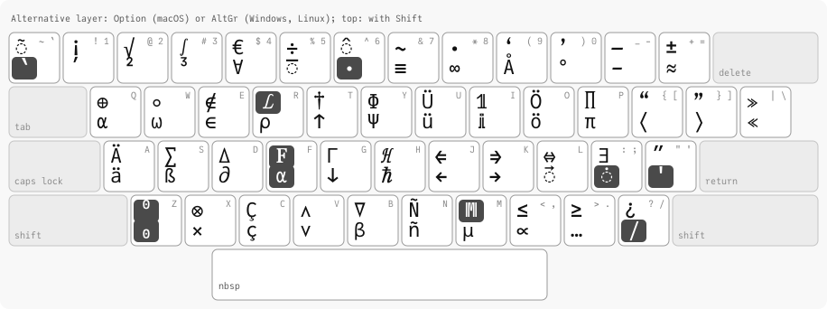
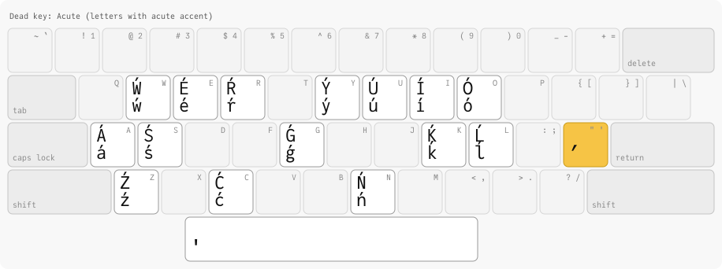
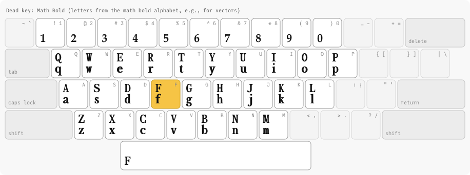

# U.S. Scientific

A keyboard layout for typing Unicode math and European accented characters directly, on a standard US keyboard, on macOS, Windows, and Linux.

Without modifiers, it is the standard US layout. The alternative layer (Option on macOS, AltGr, that is, the right Alt key, on Windows and Linux) adds:

* Umlauts and other common accented letters (ä, ö, ü, ß, ç, ñ, ğ)
* Frequently used math and physics symbols (∂, ∇, ∫, ∑, ∞, ≈, ≠, ≤, ⊗, ⟨, ⟩, ℏ, †, …)
* Combining accents that apply to the preceding character (v⃗, ẋ, ẍ, Ĥ, S̃, z̅)
* Dead keys for Greek letters, subscripts, superscripts, acute and grave accents, slash-through letters, and the bold, script, and double-struck math alphabets

The idea is to type everyday "Unicode math" (in chat, email, or web forms) without round-tripping through an editor with [digraphs](https://vimdoc.sourceforge.net/htmldoc/digraph.html) or [julia-vim](https://github.com/JuliaEditorSupport/julia-vim). The selection of symbols skews toward quantum physics.

This is the successor of [USScientific.bundle](https://github.com/goerz/USScientific.bundle), the macOS-only "U.S. International - Scientific" layout made with Ukelele.



The key notation below is the one used on macOS: `⌥` is Option (AltGr on Windows and Linux) and `⇧` is Shift.


## Alternative layer

<!-- BEGIN generated: alternative -->

#### Option or AltGr

| Keys | Character | Description |
|------|-----------|-------------|
| `` ⌥` `` | | dead key for letters with grave accent (see [Grave](#grave-dead-key)) |
| `⌥1` | `′` | prime |
| `⌥2` | `²` | square |
| `⌥3` | `³` | cube |
| `⌥4` | `∀` | for all |
| `⌥5` | `◌̅` | combining over-bar for the previous character, e.g., `z⌥5` gives `z̅` (complex conjugate) |
| `⌥6` | `⋅` | dot operator (inner product) |
| `⌥7` | `≠` | not equal |
| `⌥8` | `∞` | infinity |
| `⌥9` | `Å` | Ångström |
| `⌥0` | `°` | degree |
| `⌥-` | `–` | en-dash |
| `⌥=` | `≈` | almost equal |
| `⌥q` | `α` | Greek alpha |
| `⌥w` | `ω` | Greek omega (angular frequency) |
| `⌥e` | `∈` | element of (not to be confused with Greek `ϵ` or `ε`) |
| `⌥r` | `ρ` | Greek rho (density matrix) |
| `⌥t` | `†` | dagger (Hermitian conjugate) |
| `⌥y` | `Ψ` | Greek capital Psi (state vector) |
| `⌥u` | `ü` | umlaut |
| `⌥i` | `𝕚` | double-struck i (imaginary unit) |
| `⌥o` | `ö` | umlaut |
| `⌥p` | `π` | Greek pi |
| `⌥[` | `⟨` | left angle bracket (bra, `⟨Ψ\|`) |
| `⌥]` | `⟩` | right angle bracket (ket, `\|Ψ⟩`) |
| `⌥\` | `≪` | much less than |
| `⌥a` | `ä` | umlaut |
| `⌥s` | `ß` | German sharp s (not to be confused with Greek `β`) |
| `⌥d` | `∂` | partial derivative |
| `⌥f` | | dead key for Greek letters, plus the first few Hebrew letters used in mathematics (see [Greek](#greek-dead-key)) |
| `⌥g` | `ğ` | g with breve (Turkish) |
| `⌥h` | `ℏ` | reduced Planck constant |
| `⌥j` | `←` | left arrow |
| `⌥k` | `→` | right arrow |
| `⌥l` | `◌⃗` | combining over-arrow (vector) for the previous character, e.g., `v⌥l` gives `v⃗` |
| `⌥;` | `◌̇` | combining over-dot for the previous character, e.g., `x⌥;` gives `ẋ` (time derivative) |
| `⌥'` | | dead key for letters with acute accent (see [Acute](#acute-dead-key)) |
| `⌥z` | | dead key for subscripts (see [Subscript](#subscript-dead-key)) |
| `⌥x` | `×` | multiplication sign, e.g., `3×10⁻³` |
| `⌥c` | `ç` | c with cedilla |
| `⌥v` | `∨` | logical or |
| `⌥b` | `β` | Greek beta |
| `⌥n` | `ñ` | n with tilde |
| `⌥m` | `µ` | micro sign, e.g., `µm` |
| `⌥,` | `∝` | proportional to |
| `⌥.` | `…` | ellipsis |
| `⌥/` | | dead key for letters with a slash through them (see [Slash](#slash-dead-key)) |
| `⌥Space` |  | no-break space |

#### Shift with Option or AltGr

| Keys | Character | Description |
|------|-----------|-------------|
| `` ⌥⇧` `` | `◌̃` | combining over-tilde for the previous character, e.g., ``S⌥⇧` `` gives `S̃` (Fourier transform) |
| `⌥⇧1` | `¡` | inverted exclamation mark |
| `⌥⇧2` | `√` | square root |
| `⌥⇧3` | `∫` | integral |
| `⌥⇧4` | `€` | euro |
| `⌥⇧5` | `÷` | division sign (integer division in Julia) |
| `⌥⇧6` | `◌̂` | combining hat for the previous character, e.g., `H⌥⇧6` gives `Ĥ` (operator) |
| `⌥⇧7` | `≢` | not identical to |
| `⌥⇧8` | `⋅` | dot operator (inner product) |
| `⌥⇧9` | `‘` | left single quotation mark |
| `⌥⇧0` | `’` | right single quotation mark |
| `⌥⇧-` | `—` | em-dash |
| `⌥⇧=` | `±` | plus-minus |
| `⌥⇧q` | `⨁` | circled plus (direct sum) |
| `⌥⇧w` | `∘` | ring operator (function composition in Julia) |
| `⌥⇧e` | `∉` | not an element of |
| `⌥⇧r` | | dead key for letters from the math script alphabet, e.g., for superoperators (see [Math Script](#math-script-dead-key)) |
| `⌥⇧t` | `≡` | identical to |
| `⌥⇧y` | `Φ` | Greek capital Phi |
| `⌥⇧u` | `Ü` | umlaut |
| `⌥⇧i` | `𝟙` | double-struck 1 (identity operator) |
| `⌥⇧o` | `Ö` | umlaut |
| `⌥⇧p` | `∏` | product (not to be confused with Greek `Π`) |
| `⌥⇧[` | `“` | left double quotation mark |
| `⌥⇧]` | `”` | right double quotation mark |
| `⌥⇧\` | `≫` | much greater than |
| `⌥⇧a` | `Ä` | umlaut |
| `⌥⇧s` | `∑` | sum (not to be confused with Greek `Σ`) |
| `⌥⇧d` | `Δ` | Greek capital Delta |
| `⌥⇧f` | | dead key for letters from the math bold alphabet, e.g., for vectors (see [Math Bold](#math-bold-dead-key)) |
| `⌥⇧g` | `Γ` | Greek capital Gamma |
| `⌥⇧h` | `ℋ` | script H (Hilbert space) |
| `⌥⇧j` | `⇐` | double left arrow |
| `⌥⇧k` | `⇒` | double right arrow (implies) |
| `⌥⇧l` | `⇔` | double left-right arrow (logically equivalent) |
| `⌥⇧;` | `◌̈` | combining double dot for the previous character, e.g., `x⌥⇧;` gives `ẍ` (second time derivative) |
| `⌥⇧'` | `″` | double prime |
| `⌥⇧z` | | dead key for superscripts (see [Superscript](#superscript-dead-key)) |
| `⌥⇧x` | `⊗` | tensor (Kronecker) product |
| `⌥⇧c` | `Ç` | capital C with cedilla |
| `⌥⇧v` | `∧` | logical and |
| `⌥⇧b` | `∇` | nabla (gradient) |
| `⌥⇧n` | `Ñ` | capital N with tilde |
| `⌥⇧m` | | dead key for letters from the double-struck alphabet, e.g., for number sets (see [Double-Struck](#double-struck-dead-key)) |
| `⌥⇧,` | `≤` | less than or equal |
| `⌥⇧.` | `≥` | greater than or equal |
| `⌥⇧/` | `¿` | inverted question mark |

<!-- END generated: alternative -->

With Caps Lock on, letters are typed in uppercase, including after a dead key; the umlauts, `ç`, and `ñ` on the alternative layer are uppercased as well. Caps Lock doesn't affect any other key.


## Dead keys

A dead key types nothing by itself but changes what the next key types. Press the dead key, release it, and then press the next key. For example, `⌥f` followed by `a` gives `α`, and `⌥z` followed by `2` gives `₂`. Space after a dead key types its symbol. If the next key has no special meaning for the dead key, you get the dead key's symbol followed by the key's normal character.

In the diagrams, dead keys show their symbol on a dark badge. In each dead key's diagram, the key that triggers it is highlighted.

<!-- BEGIN generated: dead-key-table -->

| Keys | Symbol | Dead key for |
|------|--------|--------------|
| `⌥'` | `'` | [letters with acute accent](#acute-dead-key) |
| `` ⌥` `` | `` ` `` | [letters with grave accent](#grave-dead-key) |
| `⌥/` | `/` | [letters with a slash through them](#slash-dead-key) |
| `⌥f` | `α` | [Greek letters, plus the first few Hebrew letters used in mathematics](#greek-dead-key) |
| `⌥z` | `₀` | [subscripts](#subscript-dead-key) |
| `⌥⇧z` | `⁰` | [superscripts](#superscript-dead-key) |
| `⌥⇧r` | `ℒ` | [letters from the math script alphabet, e.g., for superoperators](#math-script-dead-key) |
| `⌥⇧f` | `𝐅` | [letters from the math bold alphabet, e.g., for vectors](#math-bold-dead-key) |
| `⌥⇧m` | `𝕄` | [letters from the double-struck alphabet, e.g., for number sets](#double-struck-dead-key) |

<!-- END generated: dead-key-table -->

<!-- BEGIN generated: dead-keys -->

### Acute dead key

`⌥'`, then a key: letters with acute accent. Space types `'`.



### Grave dead key

`` ⌥` ``, then a key: letters with grave accent. Space types `` ` ``.


### Slash dead key

`⌥/`, then a key: letters with a slash through them. Space types `/`.


### Greek dead key

`⌥f`, then a key: Greek letters, plus the first few Hebrew letters used in mathematics. Space types `α`.


### Subscript dead key

`⌥z`, then a key: subscripts. Space types `₀`.


With an alternative character after the dead key: `⌥b` (`β`) gives `ᵦ`, `⌥r` (`ρ`) gives `ᵨ`.

### Superscript dead key

`⌥⇧z`, then a key: superscripts. Space types `⁰`.


With an alternative character after the dead key: `⌥b` (`β`) gives `ᵝ`.

### Math Script dead key

`⌥⇧r`, then a key: letters from the math script alphabet, e.g., for superoperators. Space types `ℒ`.


### Math Bold dead key

`⌥⇧f`, then a key: letters from the math bold alphabet, e.g., for vectors. Space types `𝐅`.



### Double-Struck dead key

`⌥⇧m`, then a key: letters from the double-struck alphabet, e.g., for number sets. Space types `𝕄`.


<!-- END generated: dead-keys -->

Unicode doesn't have a complete alphabet of subscripts and superscripts, so some letters are missing. A few of the superscripts (`ꟲ`, `ꟳ`, `ꟴ`, `𐞥`) were only added in Unicode 14 and are missing from many fonts.


## Installation

Download the files from the [releases page](https://github.com/goerz/us-scientific-keyboard/releases).

From a clone of this repository, `make install` builds and installs the layout for the current user. On macOS, it installs the bundle and enables the layout right away, without logging out; select it in the input menu. `make install SYSTEM=1` installs it for all users instead (in `/Library/Keyboard Layouts`, asking for your password). On Linux, it installs the Keyman package, which requires Keyman for Linux. `make uninstall` removes it.

### macOS

Unzip `us_scientific.bundle.zip` and copy `us_scientific.bundle` to `~/Library/Keyboard Layouts/` (for the current user) or `/Library/Keyboard Layouts/` (for all users). Log out and back in. Then add the layout in System Settings, under Keyboard, Text Input, Input Sources, as "U.S. Scientific" (in the English group).

If you used the predecessor, "U.S. International - Scientific", remove its `USScientific.bundle` from the same folder.

### Windows (Keyman)

[Keyman](https://keyman.com) supports the complete layout.

1. Install [Keyman for Windows](https://keyman.com/windows/) (free). On Windows on ARM, Keyman 19.0.182 or later is required.
2. Double-click `us_scientific.kmp` and click Install. The keyboard is added under English.
3. Switch to the layout with Win+Space.

Use the **right** Alt key (AltGr) wherever this README shows `⌥`. The left Alt key keeps its usual Windows behavior.

### Windows (native layout)

There is also a native Windows keyboard layout that doesn't need Keyman. It has to be compiled on Windows with the free Visual Studio build tools, and it can't do everything:

* Native Windows dead keys can only produce characters from the Unicode Basic Multilingual Plane. The math bold dead key is therefore missing, and the script and double-struck dead keys only have the letters from the "Letterlike Symbols" block (`ℂ ℕ ℍ ℙ ℚ ℝ ℤ`, `ℬ ℰ ℱ ℋ ℐ ℒ ℳ ℛ ℯ ℊ ℴ`). The double-struck dead key's symbol is `ℍ`.
* `𝕚` and `𝟙` on AltGr+I and Shift+AltGr+I may not work in all programs.
* Shift with Caps Lock on gives lowercase letters, as usual on Windows.

Unzip `kbdussci-src.zip` on the Windows machine and follow its `README.txt`:

1. Install the [Build Tools for Visual Studio](https://visualstudio.microsoft.com/downloads/) with the "Desktop development with C++" workload and the "MSVC ARM64/ARM64EC build tools" component.
2. Open a Command Prompt in the unzipped folder and run `build.cmd`.
3. In an Administrator PowerShell, run `powershell -ExecutionPolicy Bypass -File install.ps1`, then sign out and back in.

To remove it, run `install.ps1 -Uninstall` the same way.

### Linux

[Keyman for Linux](https://keyman.com/linux/) installs the same `us_scientific.kmp` package as Keyman for Windows. This hasn't been tested.


## Changing the layout

The whole layout is defined in [`layout.toml`](layout.toml), and everything else (the files for each platform, the tables and diagrams in this README, and the PDF cheat sheet) is generated from it. The comments at the top of `layout.toml` explain the format. In short:

```toml
[alternative]  # keyed by what the key types without ⌥; uppercase/shifted means ⌥⇧
q = "α"
Q = "⨁"

[dead.greek]
key = "f"      # ⌥f
symbol = "α"

[dead.greek.map]
a = "α"
A = "Α"

[notes]        # descriptions for this README; otherwise the Unicode name is used
"ρ" = "Greek rho (density matrix)"
```

After changing it, run `make docs` to update this README and the diagrams, and `make test` to check the generated layouts.


## Building

The `Makefile` drives the [`layoutgen`](src/layoutgen) package, which needs [uv](https://docs.astral.sh/uv/):

* `make` lists the available targets. `make all` builds everything into `build/`: the macOS bundle (`make macos`), the Keyman package (`make keyman`, which also needs Node.js for Keyman's `kmc` compiler and ImageMagick for the icon), the native Windows source (`make windows`), and the PDF cheat sheet (`make cheatsheet`, which needs `rsvg-convert` and LuaLaTeX).
* `make install` and `make uninstall` install or remove the layout for the current user, as appropriate for the operating system (see [Installation](#installation)).
* `make docs` regenerates the tables and diagrams in this README.
* The diagrams and the cheat sheet are set in [JuliaMono](https://github.com/cormullion/juliamono) (SIL Open Font License), which `make fonts` downloads into `fonts/`; the diagrams contain the glyph outlines, so viewing them doesn't need the font.
* `make test` runs the tests. They check every generated layout against `layout.toml`, key by key, in every layer and dead key, and that the README is up to date.


## License

[MIT](LICENSE)
